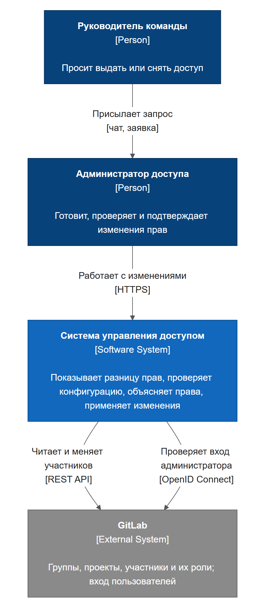
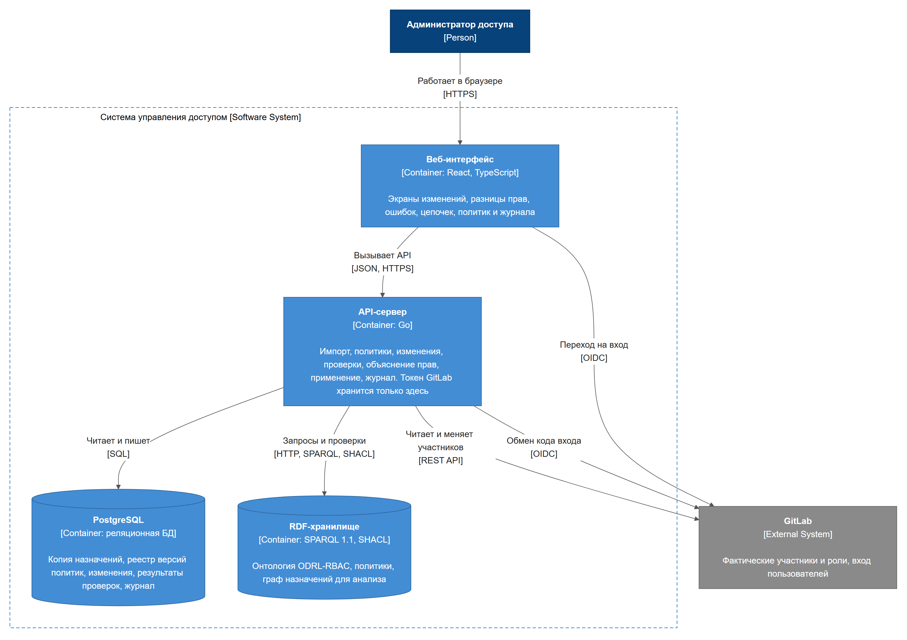
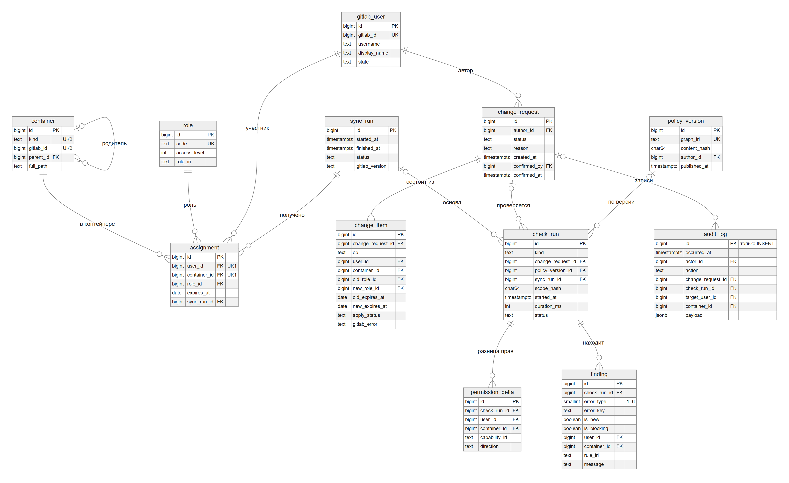
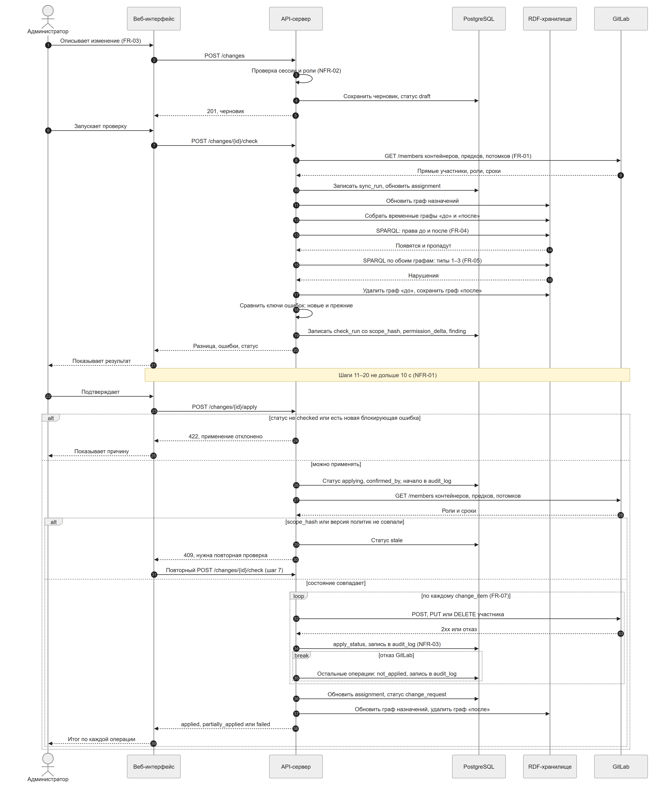
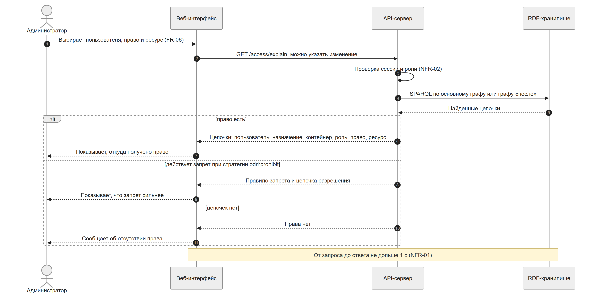
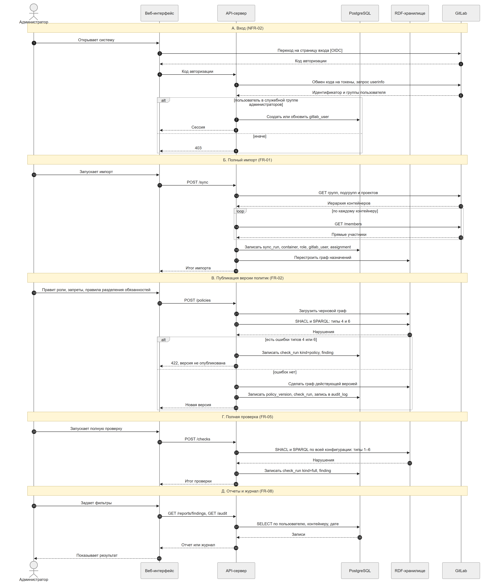
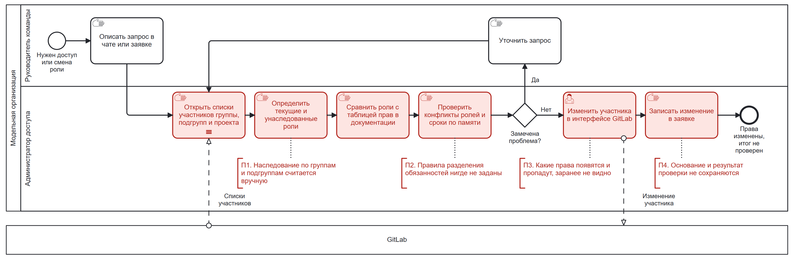
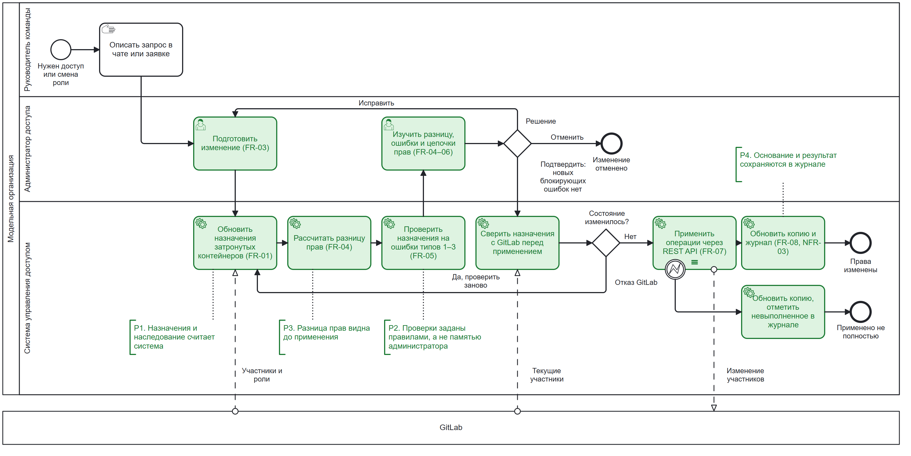

# ЛР 3 – проектирование

**Тема ВКР:** Разработка веб-системы управления ролевым доступом с онтологической проверкой политик на основе ODRL

**Автор:** Мещеряков Даниил Павлович, группа К3440 (GitHub: [Toneryy](https://github.com/Toneryy))

**Руководитель темы:** Самохин Никита Юрьевич, преподаватель факультета прикладной информатики

**Вид работы:** индивидуальная

**Согласование:** набор нотаций согласован с руководителем в переписке 02.11.2026; требования могут уточняться по ходу работы. Обоснование темы – [ЛР 2](https://github.com/Toneryy/vkr-access-control/pull/1).

## Список сокращений и условных обозначений

БД – база данных\
ВКР – выпускная квалификационная работа\
ЛР – лабораторная работа\
ПО – программное обеспечение\
API – Application Programming Interface, программный интерфейс\
ARIS – Architecture of Integrated Information Systems, методология описания бизнес-процессов\
BPMN – Business Process Model and Notation, нотация моделирования бизнес-процессов\
C4 – Context, Containers, Components, Code, модель описания архитектуры ПО\
DFD – Data Flow Diagram, диаграмма потоков данных\
DMN – Decision Model and Notation, нотация моделирования решений\
EPC – Event-driven Process Chain, событийная цепочка процессов\
ER – Entity-Relationship, модель «сущность – связь»\
FK – Foreign Key, внешний ключ\
FR – Functional Requirement, функциональное требование\
HTTP – HyperText Transfer Protocol, протокол передачи гипертекста\
HTTPS – HTTP Secure, HTTP с шифрованием\
IDEF – Integration Definition, семейство нотаций моделирования\
IRI – Internationalized Resource Identifier, идентификатор ресурса\
JSON – JavaScript Object Notation, текстовый формат данных\
NFR – Non-Functional Requirement, нефункциональное требование\
NIST – National Institute of Standards and Technology, Национальный институт стандартов и технологий США\
ODRL – Open Digital Rights Language, язык описания политик W3C\
OIDC – OpenID Connect, протокол подтверждения личности пользователя\
PK – Primary Key, первичный ключ\
RBAC – Role-Based Access Control, ролевое управление доступом\
RDF – Resource Description Framework, модель представления данных W3C\
REST – Representational State Transfer, архитектурный стиль веб-API\
SHACL – Shapes Constraint Language, язык проверки RDF-данных W3C\
SPARQL – SPARQL Protocol and RDF Query Language, язык запросов к RDF-данным\
SQL – Structured Query Language, язык запросов к реляционным БД\
UK – Unique Key, уникальный ключ\
UML – Unified Modeling Language, унифицированный язык моделирования\
W3C – World Wide Web Consortium, консорциум Всемирной паутины\
XML – eXtensible Markup Language, расширяемый язык разметки

## 1 Предметная область и требования

### 1.1 Описание предметной области

Система проектируется для организации, которая ведет разработку в GitLab. Организация модельная: данные реальных компаний в работе не используются.

В GitLab права выдаются ролями на уровнях группы, подгруппы и проекта и наследуются вниз по иерархии [1]. Основных ролей семь: Guest, Planner, Reporter, Security Manager (в статусе бета), Developer, Maintainer и Owner; на платных планах есть еще Minimal Access. У назначения может быть срок действия [2, 3]. В подгруппе или проекте нельзя выдать роль ниже унаследованной [4]. Модель соответствует ролевому управлению доступом RBAC [5], при этом роль всегда действует в конкретном контейнере, то есть в группе или проекте.

В документации GitLab по ролям нет запретов и правил разделения обязанностей [1], поэтому в системе они задаются как правила организации. Система не вмешивается в работу GitLab: решения о доступе в реальном времени по-прежнему принимает он. Система показывает последствия изменения до его применения, находит ошибки конфигурации, объясняет происхождение прав и не дает применить изменение с новой блокирующей ошибкой.

Участники процесса:

- руководитель команды формулирует запрос на доступ и в системе не работает;
- администратор доступа (один или несколько сотрудников из служебной группы) готовит, проверяет и подтверждает изменения;
- GitLab хранит фактические назначения и выполняет изменения.

Границы первой версии:

- целевая система одна – GitLab;
- маршрутов согласования заявок нет;
- учитываются прямые назначения в группах и проектах и их наследование вниз, доступ через приглашение группы в другую группу или проект в разнице прав и проверках не учитывается;
- пользовательские роли GitLab, доступные только на плане Ultimate [6], не импортируются.

Типы ошибок конфигурации определены в ЛР 2, в таблице 1 для каждого типа указан уровень важности.

Таблица 1 – Типы ошибок конфигурации и их уровни

| Тип | Ошибка | Когда проверяется | Уровень | Почему выбран такой уровень |
|---|---|---|---|---|
| 1 | Нарушение разделения обязанностей: у пользователя конфликтующие роли в контейнере с учетом вложенности | При изменении | Блокирует применение изменения | Прямо нарушает заданное правило организации |
| 2 | Лишнее назначение, перекрытое ролью не ниже в вышестоящем контейнере | При изменении | Предупреждение | Для стандартных ролей не прибавляет прав |
| 3 | Назначение с истекшим сроком, еще не удаленное GitLab, или устаревшая запись в копии | При изменении | Предупреждение | GitLab удаляет такие записи фоновой задачей [7], ошибка временная |
| 4 | Конфликт разрешения и запрета в политике, где не задана стратегия odrl:perm или odrl:prohibit | При публикации | Блокирует публикацию политик | По ODRL без заданной стратегии конфликт делает всю политику недействительной [8] |
| 5 | Неиспользуемая роль или недостижимое право | Только при полной проверке | Предупреждение | На текущий доступ не влияет |
| 6 | Нарушение структуры политики | При публикации | Блокирует публикацию политик | Некорректную политику нельзя надежно проверить остальными правилами |

Проверки разнесены по событиям. Типы 4 и 6 зависят только от политики: версия с такими ошибками не публикуется, поэтому действующая версия всегда корректна и при изменении назначений их не проверяют. Тип 5 – свойство всей конфигурации, на части графа он дал бы ложные срабатывания, поэтому его ищет только полная проверка, которая охватывает все шесть типов. При изменении назначений блокирует только новая ошибка типа 1, то есть та, которую вносит само изменение. Ошибки, существовавшие раньше, показываются, но не мешают работе: иначе одна старая ошибка остановила бы все изменения в организации. Новая ошибка определяется сравнением ключей (тип, пользователь, контейнер, правило) на графах «до» и «после» изменения.

### 1.2 Функциональные требования

Функциональные требования приведены в таблице 2.

Таблица 2 – Функциональные требования

| ID | Требование | Как проверить выполнение |
|---|---|---|
| FR-01 | Импорт групп, подгрупп, проектов, прямых участников, их ролей и сроков из GitLab через REST API | После импорта состав участников и роли совпадают с GitLab на тестовом экземпляре |
| FR-02 | Ведение политик в формате ODRL 2.2 с профилем RBAC: роли и их права, запреты, правила разделения обязанностей; каждая публикация создает новую версию, версия с ошибками типов 4 или 6 не публикуется | Выгрузка проходит проверку формами SHACL профиля, предыдущая версия доступна, версия с заложенной ошибкой типа 6 отклоняется |
| FR-03 | Подготовка изменения прямых назначений (выдать, снять, изменить роль, задать срок) без немедленного применения | Изменение сохраняется со статусом draft, в GitLab ничего не меняется |
| FR-04 | Расчет разницы прав до применения: какие права у каких пользователей появятся и пропадут | На тестовой конфигурации разница совпадает с ручным расчетом |
| FR-05 | Проверка конфигурации на ошибки типов 1–6 при событиях из таблицы 1 с разделением на новые и существовавшие | На отложенных тестовых наборах найдены все заложенные ошибки, ложных срабатываний нет |
| FR-06 | Объяснение права цепочкой «пользователь – назначение – контейнер – роль – право – ресурс» для текущей конфигурации и для подготовленного изменения | Для любого права из тестового набора цепочка совпадает с эталоном |
| FR-07 | Применение подтвержденного изменения в GitLab через REST API; при новой блокирующей ошибке или устаревшей проверке сервер отклоняет применение | После применения участники в GitLab соответствуют изменению; прямой вызов API для изменения с блокирующей ошибкой получает 422 |
| FR-08 | Отчет по ошибкам конфигурации и журнал изменений с фильтрами по пользователю, контейнеру и дате | На журнале с известным составом записей каждый фильтр возвращает ожидаемое подмножество |

### 1.3 Нефункциональные требования

Нефункциональные требования приведены в таблице 3.

Таблица 3 – Нефункциональные требования

| ID | Требование | Как проверить выполнение |
|---|---|---|
| NFR-01 | Проверка изменения на конфигурации масштаба americas_small занимает не более 10 с, объяснение права – не более 1 с; чтение GitLab и обновление копии не учитываются | Замер на стенде, 10 прогонов, с пределом сравнивается максимум |
| NFR-02 | Вход только через GitLab по OIDC; работать в системе могут только участники служебной группы администраторов; токен для вызовов GitLab хранится на сервере и не передается в браузер | Запрос без сессии получает 401, пользователь вне группы – 403, токена нет в ответах API |
| NFR-03 | Каждая операция применения журналируется: кто, когда, что изменил, результат проверки; журнал только дополняется | На каждую операцию есть запись; изменить или удалить запись нельзя ни через API, ни под учетной записью приложения в БД |
| NFR-04 | Система разворачивается на серверах организации без облачных сервисов, развертывание выполняется одной командой | Система поднимается на чистой машине через Docker Compose [9] |
| NFR-05 | Политики выгружаются в открытом формате ODRL 2.2 (Turtle) и переносятся без потерь | Выгрузка, загруженная в пустое хранилище, дает те же результаты проверок; файл открывается в Protégé [10] |

Набор americas_small содержит 3477 пользователей, 1587 прав и 105 205 назначений [11]. Он задает только матрицу «пользователь – право», иерархию контейнеров и роли для него строит генератор (ЛР 2, подраздел 4.4). Пределы NFR-01 взяты из ЛР 2: 10 с – граница удержания внимания на диалоге, 1 с – граница, при которой не прерывается ход мысли [12]. Это рабочая гипотеза, значения уточняются после выбора хранилища.

В ЛР 2 для входа администраторов назывался Keycloak. При проектировании он исключен: целевая система одна, а GitLab сам работает как поставщик OIDC [13, 14], поэтому отдельный сервер учетных записей добавил бы компонент без новой функции.

## 2 Обзор нотаций и видов диаграмм

Обзор приведен в таблице 4.

Таблица 4 – Обзор нотаций и видов диаграмм

| Нотация или вид диаграммы | Что описывает | Сильные стороны при проектировании |
|---|---|---|
| BPMN [15] | Бизнес-процессы: участники, задачи, события, ветвления, сообщения | Показывает обработку исключений и обмен между участниками; модель сохраняется в стандартном XML |
| IDEF0 [16, 17] | Функции: входы, выходы, управление, механизмы | Строгая иерархическая декомпозиция функций системы |
| IDEF3 [18] | Процессы: последовательность работ и логика их связи | Фиксирует порядок и варианты выполнения со слов экспертов |
| EPC [19] | Процессы как чередование событий и функций | Понятна бизнес-пользователям, поддержана в методологии ARIS |
| DFD [20] | Потоки данных между процессами, хранилищами и внешними сущностями | Показывает, откуда данные приходят и где хранятся |
| ER-модель [21] | Данные: сущности, атрибуты, связи и кратность | Напрямую переводится в схему реляционной БД |
| UML, диаграмма вариантов использования [22] | Функции системы с точки зрения пользователей | Быстро задает границы системы и роли |
| UML, диаграмма последовательностей [22] | Взаимодействия: сообщения между участниками во времени | Видны порядок вызовов, ветки и циклы конкретного сценария |
| UML, диаграмма состояний [22] | Поведение: состояния объекта и переходы | Помогает проверить полноту жизненного цикла объекта |
| UML, диаграммы компонентов и развертывания [22] | Архитектура: модули, интерфейсы, размещение на узлах | Стандартизованное описание структуры и размещения |
| C4 [23] | Архитектура на уровнях контекста, контейнеров, компонентов и кода | Одна система описывается с разной детализацией, понятной и разработчику, и заказчику |
| DMN [24] | Правила принятия решений: таблицы решений и их зависимости | Отделяет логику решений от процесса |
| ArchiMate [25] | Архитектура предприятия: бизнес, приложения, технологии | Связывает слои предприятия в одной модели |

## 3 Выбор нотаций для проекта

Требования из таблиц 2 и 3 касаются трех сторон системы: процесса выдачи прав, хранимых данных и совместной работы компонентов. Выбраны четыре нотации, они приведены в таблице 5:

- бизнес-логику отражает BPMN;
- структуру данных и модель БД отражает ER-модель;
- взаимодействие компонентов и потоки данных отражают C4 и диаграмма последовательностей UML.

Таблица 5 – Выбранные нотации

| Нотация или вид диаграммы | Что моделируем | Связанные требования | Почему подходит |
|---|---|---|---|
| BPMN | Процесс изменения прав, AS-IS и TO-BE | FR-01, FR-03–FR-08, NFR-03 | Есть дорожки участников и сообщения в GitLab, поэтому видно, что перешло от человека к системе; граничное событие показывает отказ GitLab |
| ER-модель | Таблицы PostgreSQL: копия назначений, изменения, результаты проверок, журнал | FR-01–FR-05, FR-07, FR-08, NFR-03 | Требования к хранению и журналу выражаются ключами и связями |
| C4, уровни контекста и контейнеров | Границы системы, контейнеры, протоколы | FR-01–FR-08 (через компоненты в таблице 8), NFR-01–NFR-05 | Показывает технологии, протоколы и место хранения токена |
| UML, диаграмма последовательностей | Изменение прав, объяснение права, вход, импорт, публикация политик, отчеты | FR-01–FR-08, NFR-01–NFR-03 | Показывает порядок проверок и отрезки, на которые действуют пределы времени |

Остальные позиции обзора не выбраны:

- IDEF0 и IDEF3 слабее BPMN в описании обмена с внешней системой и исключений, EPC дублирует BPMN;
- DFD не показывает порядок операций, важный для FR-07;
- DMN подошла бы для правил проверки, но они уже выражаются на SHACL и SPARQL, выбранных в ЛР 2;
- нотация ArchiMate рассчитана на уровень предприятия, а проектируется одна система;
- диаграмма вариантов использования при одной роли пользователя почти не добавляет сведений;
- диаграммы компонентов и развертывания перекрываются уровнями C4 и таблицей 8;
- диаграмма состояний не вошла в согласованный набор, жизненный цикл изменения задан таблицей 9.

Таблица 6 показывает, какая модель позволяет проверить каждое требование. Номера шагов относятся к рисунку 4, если не указано иное.

Таблица 6 – Связь требований с элементами моделей

| Требование | BPMN TO-BE (рисунок 8) | ER-модель (рисунок 3) | C4 (рисунки 1 и 2, таблица 8) | Последовательность |
|---|---|---|---|---|
| FR-01 | «Обновить назначения», сообщение «Участники и роли» | gitlab_user, container, assignment, sync_run | Связь API-сервера с GitLab, компонент «Импорт» | Шаги 8–11, рисунок 6, блок Б |
| FR-02 | – | policy_version | RDF-хранилище, компонент «Политики» | Рисунок 6, блок В |
| FR-03 | «Подготовить изменение» | change_request, change_item | Компонент «Изменения» | Шаги 1–5 |
| FR-04 | «Рассчитать разницу прав» | permission_delta | Компонент «Расчет разницы» | Шаги 12–14 |
| FR-05 | «Проверить назначения» | check_run, finding (error_key, is_new) | Компонент «Проверки» | Шаги 15–19, рисунок 6, блоки В и Г |
| FR-06 | «Изучить разницу, ошибки и цепочки» | – (цепочки вычисляются при запросе) | Компонент «Объяснение прав» | Рисунок 5 |
| FR-07 | Шлюз «Решение», «Сверить назначения», «Применить операции», граничное событие | change_item (apply_status, gitlab_error) | Связь API-сервера с GitLab, компонент «Применение» | Шаги 23–36 |
| FR-08 | «Обновить копию и журнал» | audit_log, finding | Компонент «Отчеты и журнал» | Шаг 34, рисунок 6, блок Д |
| NFR-01 | – | – | Проверки вынесены в RDF-хранилище | Примечания на рисунках 4 и 5 |
| NFR-02 | – | – | Вход по OIDC, токен только на API-сервере | Шаг 3, рисунок 5, рисунок 6, блок А |
| NFR-03 | «Обновить копию и журнал», «Обновить копию, отметить невыполненное в журнале» | audit_log, только INSERT | PostgreSQL | Шаги 26, 34, 35 |
| NFR-04 | – | – | Четыре контейнера | – |
| NFR-05 | – | – | RDF-хранилище | – |

## 4 Модели системы

Модель процесса в BPMN приведена в разделе 5. Исходные файлы всех диаграмм лежат в `assets/design/src/`: BPMN 2.0 XML и текстовые описания Mermaid.

### 4.1 Архитектура системы

**Диаграмма:** контекст системы (уровень 1 модели C4) показан на рисунке 1, контейнеры (уровень 2) – на рисунке 2. Темно-синим обозначены люди, синим – разрабатываемая система и ее контейнеры, серым – внешняя система, стрелки подписаны назначением и протоколом.

Рисунок 1 – Контекст системы

Рисунок 2 – Контейнеры системы

**Пояснение модели:** система состоит из четырех контейнеров. Go, React и TypeScript выбраны по опыту автора и стеку темы. Главное архитектурное решение – разделение данных по трем местам, оно приведено в таблице 7.

Таблица 7 – Распределение данных между хранилищами

| Данные | Где находятся | Роль этого места |
|---|---|---|
| Фактические участники, роли, сроки | GitLab | Источник истины, система только читает их и применяет подтвержденные изменения |
| Копия назначений, реестр версий политик, изменения, результаты проверок, журнал | PostgreSQL | Данные приложения: транзакции, ограничения, только дополняемый журнал |
| Онтология ODRL-RBAC, роли и их права, запреты, правила разделения обязанностей, граф назначений | RDF-хранилище | Анализ: проверки SHACL и SPARQL, обход иерархий, выгрузка в открытом формате |

RDF-хранилище не заменяет основную БД. Правила и роли в нем являются первичными данными, а граф назначений строится из копии в PostgreSQL и может быть пересобран. Хранить политики в RDF выгодно по трем причинам: формат ODRL открыт и задает модель правил [8], проверки структуры выражаются формами SHACL [26], а обход вложенных групп и иерархии ролей – путями SPARQL [27]. В учебном проекте по инженерии знаний те же средства уже применялись, но запросы по иерархиям выполнялись до 19,7 с (ЛР 2, таблица 6). Поэтому хранилище выбирается по замерам, а проверяется только затронутая часть графа.

Кандидаты – Apache Jena Fuseki и Oxigraph (ЛР 2). В Fuseki есть служба проверки SHACL [28], в описании Oxigraph она не заявлена [29], при его выборе проверку SHACL придется выполнять отдельно. Поэтому на рисунке 2 указаны требования к хранилищу, а не продукт.

Изменение описывается наборами добавляемых и удаляемых назначений. Для проверки собираются два временных графа: «до» – затронутая часть основного графа вместе с действующей версией политик, «после» – та же часть минус удаляемые и плюс добавляемые назначения. В затронутую часть входят контейнеры из change_item, их предки и потомки. Вывод выполняется отдельно для каждого графа, основной граф до применения не меняется. Граф «до» после проверки удаляется, граф «после» хранится до применения, отмены или новой проверки, чтобы объяснять права для подготовленного изменения без повторной сборки.

Состав API-сервера приведен в таблице 8.

Таблица 8 – Компоненты API-сервера

| Компонент | Что делает | Требования | С чем работает |
|---|---|---|---|
| HTTP-слой | Маршруты, сессии, проверка роли при каждом запросе | NFR-02 | Веб-интерфейс, GitLab (OIDC) |
| Импорт | Загружает структуру и прямых участников | FR-01 | GitLab, PostgreSQL, RDF-хранилище |
| Политики | Проверяет и публикует версии политик, выгружает их | FR-02, NFR-05 | RDF-хранилище, PostgreSQL |
| Изменения | Хранит черновики, ведет статусы | FR-03 | PostgreSQL |
| Расчет разницы | Собирает графы, сравнивает права до и после | FR-04 | RDF-хранилище, PostgreSQL |
| Проверки | Запускает проверки типов 1–6, определяет новые ошибки | FR-05 | RDF-хранилище, PostgreSQL |
| Объяснение прав | Строит цепочки | FR-06 | RDF-хранилище |
| Применение | Сверяет состояние, выполняет операции | FR-07 | GitLab, PostgreSQL, RDF-хранилище |
| Отчеты и журнал | Запись и чтение журнала, отчеты | FR-08, NFR-03 | PostgreSQL |

**Отраженные функциональные требования и элементы модели:** импорт и применение (FR-01, FR-07) идут по связи с GitLab, политики (FR-02) лежат в RDF-хранилище, остальные функции распределены по таблице 8.

**Нефункциональные требования и проектные решения:**

- NFR-01: проверяется только затронутая часть графа, хранилище выбирается по замерам.
- NFR-02: вход по OIDC; членство в служебной группе берется при входе из поля groups ответа userinfo [13], срок сессии ограничен, чтобы исключенный из группы сотрудник быстро терял доступ. Для вызовов GitLab используется токен группы с областью api [30] и ролью Owner, так как только Owner управляет участниками группы [1]. Это самый чувствительный секрет: он хранится в секрете контейнера API-сервера, имеет срок действия и заменяется по регламенту.
- NFR-04: четыре контейнера разворачиваются одной конфигурацией Docker Compose, внешняя система одна – собственный GitLab организации.
- NFR-05: политики хранятся в ODRL 2.2, выгрузка не требует преобразования, полнота проверяется обратной загрузкой.

### 4.2 Модель данных

**Диаграмма:** ER-модель БД показана на рисунке 3 в нотации «вороньих лапок». Ссылки на gitlab_user, container и role из таблиц change_item, permission_delta, finding и audit_log, а также confirmed_by, policy_version.author_id и audit_log.check_run_id показаны столбцами FK, линии для них опущены ради читаемости. Метками UK1 и UK2 отмечены составные уникальные ключи.

Рисунок 3 – ER-модель основной БД

**Пояснение модели:** assignment – копия прямых назначений из GitLab, sync_run – прогоны импорта. Вокруг change_request сгруппированы операции изменения, а результаты проверок относятся к check_run, поэтому повторная проверка не затирает предыдущую. Поле check_run.kind принимает значения change, policy и full, change_item.op – add, update и remove, permission_delta.direction – gained и lost, change_item.apply_status – pending, invalid, applied, failed и not_applied, поля status в sync_run и check_run – running, done и failed, audit_log.action – change_started, item_applied, item_failed, change_finished и policy_published. Отклоненная версия политик в policy_version не попадает, у ее проверки policy_version_id пуст, а у проверок политик и полных проверок может быть пуст sync_run_id. В finding поля user_id и container_id могут быть пустыми: ошибки типов 4–6 относятся к политике. Жизненный цикл изменения задан в таблице 9.

Таблица 9 – Статусы изменения

| Статус | Значение | Следующие статусы |
|---|---|---|
| draft | Черновик | checked, blocked, cancelled |
| checked | Проверка прошла, новых блокирующих ошибок нет | applying, draft, cancelled |
| blocked | Есть новая ошибка типа 1 или недопустимая операция | draft, cancelled |
| applying | Изменение подтверждено, идет применение | stale, applied, partially_applied, failed |
| stale | После проверки изменились назначения или версия политик | checked, blocked, draft, cancelled |
| applied | Все операции выполнены | конечный |
| partially_applied | Часть операций выполнена, остальные не применены | конечный |
| failed | Ни одна операция не выполнена | конечный |
| cancelled | Отменено администратором | конечный |

Если сервер остановился во время применения, при запуске изменения в статусе applying сверяются с GitLab и журналом и получают статус applied, partially_applied или failed.

Прямых внешних ключей между PostgreSQL и RDF-хранилищем быть не может, поэтому связь идет через идентификаторы role_iri, capability_iri, rule_iri и graph_iri. Таблицы соответствуют классам онтологии, созданной в учебном проекте:

- gitlab_user – rbac:User;
- container – rbac:Group и rbac:Project со свойством rbac:parent;
- role – rbac:Role;
- assignment – rbac:RoleAssignment со свойствами rbac:member, rbac:assignedRole, rbac:inContainer и rbac:expiresOn.

**Отраженные функциональные требования и элементы модели:** FR-01 – gitlab_user, container, role, assignment, sync_run; FR-02 – policy_version; FR-03 – change_request, change_item; FR-04 – permission_delta; FR-05 – check_run, finding; FR-07 – apply_status и gitlab_error в change_item; FR-08 – finding и audit_log, в котором есть actor_id, target_user_id, container_id и occurred_at для фильтров.

**Нефункциональные требования и проектные решения:**

- NFR-03: таблицей audit_log владеет отдельная роль миграций, роль приложения получает только INSERT и SELECT. Триггер дополнительно отклоняет UPDATE, DELETE и TRUNCATE, для TRUNCATE нужен отдельный триггер [31]. Внешние ключи журнала объявлены без каскадов.
- NFR-03: audit_log.check_run_id связывает запись с результатом проверки, версию политик дает check_run.policy_version_id.
- Целостность копии: пара (user_id, container_id) уникальна, так как у пользователя в контейнере одна прямая запись; пара (kind, gitlab_id) уникальна, так как идентификаторы групп и проектов независимы.

### 4.3 Сценарии взаимодействия

**Диаграмма:** основной сценарий показан на рисунке 4 (UML, диаграмма последовательностей), объяснение права – на рисунке 5, вход, полный импорт, публикация политик, полная проверка и отчеты – на рисунке 6.

Рисунок 4 – Сценарий «изменение – проверка – применение»

Рисунок 5 – Сценарий объяснения права

Рисунок 6 – Вход, полный импорт, публикация политик, полная проверка, отчеты

**Пояснение модели:** шаги 1–5 создают черновик и не затрагивают GitLab. Шаги 6–21 обновляют назначения затронутых контейнеров, их предков и потомков, считают разницу и проверяют назначения. Участники читаются запросом /members каждого контейнера: он возвращает только прямых участников, а запрос /members/all для одного пользователя отдает лишь наивысшую роль и не позволяет построить цепочку [2].

Интерфейс не дает подтвердить изменение с блокирующей ошибкой, но решение принимает сервер: при неподходящем статусе или новой блокирующей ошибке он отвечает 422 (шаг 24). Перед применением система заново читает участников тех же контейнеров (шаги 27–28) и сравнивает хеш прочитанных назначений с check_run.scope_hash, а также версию политик. Копию в assignment для этого брать нельзя: ее могла обновить другая проверка. При расхождении изменение получает статус stale, и интерфейс запускает проверку заново. Условной записи в API GitLab нет, поэтому окно гонки между шагами 28 и 32 сужается, но не устраняется.

Операции применения выполняются по одной, чтобы получить результат по каждой: транзакции на несколько операций в API нет. При первом отказе GitLab оставшиеся операции не выполняются и отмечаются в журнале (шаг 35). Запись в журнал сделана до начала цикла и после каждой операции, поэтому сбой сервера не оставит изменения в GitLab без следа.

При снятии участника группы система передает skip_subresources=true, чтобы не удалить прямые членства в подгруппах и проектах [2]: иначе фактическая разница разошлась бы с рассчитанной. Изменять можно только прямые назначения. Роль, равная унаследованной, – это ошибка типа 2. Роль ниже унаследованной GitLab не допустит [4], поэтому это не ошибка конфигурации, а недопустимая операция: проверка отмечает ее значением invalid в change_item, и изменение получает статус blocked.

Запрет действует как правило модели. На рисунке 5 ветка «действует запрет» показывает случай, когда в политике задана стратегия odrl:prohibit и запрет сильнее разрешения [8], при этом в GitLab такое право может фактически быть, и система показывает это расхождение.

**Отраженные функциональные требования и элементы модели:** номера шагов приведены в таблице 6.

**Нефункциональные требования и проектные решения:**

- NFR-01: примечания на рисунках 4 и 5 отмечают отрезки с пределами 10 с и 1 с, чтение GitLab и обновление копии (шаги 8–10) в предел не входят.
- NFR-02: проверка сессии и роли выполняется при каждом запросе до обращения к данным (шаг 3 показывает ее один раз), вход показан в блоке А рисунка 6.
- NFR-03: журнал пополняется на шагах 26, 34 и 35.

## 5 Сравнение текущего и целевого процессов

**Выбранная нотация:** BPMN. Обе диаграммы хранятся в виде BPMN 2.0 XML и открываются в редакторах BPMN.

### 5.1 Текущий процесс

**Диаграмма:** процесс AS-IS показан на рисунке 7, красным отмечены проблемные шаги, метками П1–П4 – проблемы.

Рисунок 7 – Процесс изменения прав без системы (AS-IS)

**Описание и ограничения:** администратор получает запрос и вручную просматривает списки участников каждого уровня. Роли он сверяет с таблицей прав в документации, а конфликты проверяет по памяти. Какие права появятся и пропадут, становится видно только после изменения. Описан типовой процесс модельной организации, замеров времени и числа ошибок для него нет.

### 5.2 Целевой процесс

**Диаграмма:** процесс TO-BE показан на рисунке 8, зеленым отмечены новые и измененные шаги, метками Р1–Р4 – решения проблем П1–П4.

Рисунок 8 – Процесс изменения прав с системой (TO-BE)

**Описание изменений:** администратор описывает изменение, система обновляет назначения, считает разницу и проверяет конфигурацию. Администратор изучает результат и решает: исправить, отменить или подтвердить. Перед применением система сверяет состояние с GitLab, при расхождении процесс возвращается к обновлению назначений. Операции применяются по одной, отказ GitLab обрабатывается граничным событием, копия обновляется, а процесс завершается отдельным исходом «Применено не полностью». Уточнение запроса у руководителя команды остается вне системы.

### 5.3 Обоснование перехода

Сравнение процессов приведено в таблице 10.

Таблица 10 – Сравнение процессов AS-IS и TO-BE

| Метка | Проблема AS-IS (рисунок 7) | Решение TO-BE (рисунок 8) | Требования |
|---|---|---|---|
| П1, Р1 | Наследование считается вручную по нескольким спискам | Импорт, расчет наследования и цепочка прав | FR-01, FR-06 |
| П2, Р2 | Конфликты проверяются по памяти | Проверки типов 1–6, блокировка при новой ошибке типа 1 | FR-05, FR-07 |
| П3, Р3 | Последствия видны после изменения | Разница прав видна до применения | FR-04 |
| П4, Р4 | Основание и результат не сохраняются | Журнал, который только дополняется | FR-08, NFR-03 |
| – | Изменения в GitLab во время работы не отслеживаются | Сверка перед применением | FR-07 |
| – | Сбой применения не имеет отдельной ветки | Граничное событие, результат по каждой операции | FR-07, NFR-03 |

Четыре задачи анализа AS-IS («Открыть списки», «Определить роли», «Сравнить роли с таблицей», «Проверить конфликты») в TO-BE выполняет система, за администратором остается решение по готовому результату. На схемах это видно по переходу красных задач из дорожки администратора в зеленые задачи дорожки системы. Сокращение времени работы здесь не заявляется, его можно оценить только после испытаний.

## 6 Выводы

Согласованность процесса, взаимодействий и данных проверена по шагам процесса TO-BE, результат приведен в таблице 11.

Таблица 11 – Согласованность процесса, взаимодействий и данных

| Шаг TO-BE | Вызов API | Компонент | Таблицы |
|---|---|---|---|
| Подготовить изменение | POST /changes | Изменения | change_request, change_item |
| Обновить назначения | POST /changes/{id}/check | Импорт | assignment, sync_run |
| Рассчитать разницу прав | POST /changes/{id}/check | Расчет разницы | permission_delta, check_run |
| Проверить назначения | POST /changes/{id}/check | Проверки | check_run, finding |
| Изучить разницу, ошибки и цепочки | GET /changes/{id}, GET /access/explain | Изменения, Объяснение прав | permission_delta, finding |
| Сверить назначения | POST /changes/{id}/apply | Применение | check_run (scope_hash), change_request |
| Применить операции | POST /changes/{id}/apply | Применение | change_item, audit_log |
| Обновить копию и журнал | POST /changes/{id}/apply | Применение, Отчеты и журнал | assignment, change_request, audit_log |
| Обновить копию, отметить невыполненное в журнале | POST /changes/{id}/apply | Применение, Отчеты и журнал | assignment, change_item, audit_log |

**Почему выбранные нотации адекватно отражают предметную область и цели ВКР.** Цель ВКР (ЛР 2, подраздел 4.2) – система, которая хранит политики в ODRL 2.2, проверяет каждое изменение до применения и объясняет права. BPMN фиксирует перенос проверок от человека к системе, ER-модель – состав хранимых данных и журнала, C4 – разделение между GitLab, PostgreSQL и RDF-хранилищем, диаграммы последовательностей – порядок проверок и применения.

**Как модели подтверждают выполнение требований.** Таблица 6 связывает требования с элементами моделей, а способы проверки приведены в таблицах 2 и 3. Требования FR-02, NFR-04 и NFR-05 не относятся к процессу изменения прав и поэтому в BPMN не показаны. Модели показывают, как выполняются функции, а значения NFR-01 подтвердятся только замерами на этапе реализации.

**Где достигнуто улучшение в TO-BE.** Анализ перенесен на систему, проверка и предпросмотр выполняются до изменения, появились сверка перед применением и журнал (таблица 10, рисунки 7 и 8).

**Что показал этап проектирования.** Процессы, данные и взаимодействия согласованы (таблица 11). Проектирование уточнило решения ЛР 2: RDF-хранилище отведено под политики и анализ, данные приложения хранятся в PostgreSQL, Keycloak исключен, проверки разнесены по событиям, введены уровни ошибок и сверка перед применением, в цепочку прав добавлен контейнер.

## Список использованных источников

1. Roles and permissions [Электронный ресурс] // GitLab Docs. URL: [docs.gitlab.com/user/permissions](https://docs.gitlab.com/user/permissions/) (дата обращения: 09.11.2026).
2. Groups members API [Электронный ресурс] // GitLab Docs. URL: [docs.gitlab.com/api/members](https://docs.gitlab.com/api/members/) (дата обращения: 09.11.2026).
3. Project members API [Электронный ресурс] // GitLab Docs. URL: [docs.gitlab.com/api/project_members](https://docs.gitlab.com/api/project_members/) (дата обращения: 09.11.2026).
4. Subgroups [Электронный ресурс] // GitLab Docs. URL: [docs.gitlab.com/user/group/subgroups](https://docs.gitlab.com/user/group/subgroups/) (дата обращения: 09.11.2026).
5. Ferraiolo D. F., Sandhu R., Gavrila S. et al. Proposed NIST Standard for Role-Based Access Control // ACM Transactions on Information and System Security. 2001. Vol. 4, No. 3. P. 224–274. DOI: [10.1145/501978.501980](https://doi.org/10.1145/501978.501980).
6. Custom roles [Электронный ресурс] // GitLab Docs. URL: [docs.gitlab.com/user/custom_roles](https://docs.gitlab.com/user/custom_roles/) (дата обращения: 09.11.2026).
7. Файл app/models/member.rb [Электронный ресурс] // Исходный код GitLab. URL: [gitlab.com/gitlab-org/gitlab](https://gitlab.com/gitlab-org/gitlab/-/blob/master/app/models/member.rb) (дата обращения: 09.11.2026).
8. Iannella R., Villata S. ODRL Information Model 2.2 [Электронный ресурс] : W3C Recommendation 15 February 2018. URL: [w3.org/TR/odrl-model](https://www.w3.org/TR/odrl-model/) (дата обращения: 09.11.2026).
9. Docker Compose [Электронный ресурс] // Docker Docs. URL: [docs.docker.com/compose](https://docs.docker.com/compose/) (дата обращения: 09.11.2026).
10. Protégé [Электронный ресурс] // Stanford University. URL: [protege.stanford.edu](https://protege.stanford.edu/) (дата обращения: 09.11.2026).
11. Ene A., Horne W., Milosavljevic N. et al. Fast Exact and Heuristic Methods for Role Minimization Problems // Proceedings of the 13th ACM Symposium on Access Control Models and Technologies (SACMAT '08). New York : ACM, 2008. P. 1–10. DOI: [10.1145/1377836.1377838](https://doi.org/10.1145/1377836.1377838).
12. Nielsen J. Response Times: The 3 Important Limits [Электронный ресурс] // Nielsen Norman Group. 1993, обновлено 2014. URL: [nngroup.com/articles/response-times-3-important-limits](https://www.nngroup.com/articles/response-times-3-important-limits/) (дата обращения: 09.11.2026).
13. GitLab as OpenID Connect identity provider [Электронный ресурс] // GitLab Docs. URL: [docs.gitlab.com/integration/openid_connect_provider](https://docs.gitlab.com/integration/openid_connect_provider/) (дата обращения: 09.11.2026).
14. Sakimura N., Bradley J., Jones M. et al. OpenID Connect Core 1.0 [Электронный ресурс] // OpenID Foundation. URL: [openid.net/specs/openid-connect-core-1_0.html](https://openid.net/specs/openid-connect-core-1_0.html) (дата обращения: 09.11.2026).
15. Business Process Model and Notation (BPMN). Version 2.0.2 [Электронный ресурс] // Object Management Group. 2014. URL: [omg.org/spec/BPMN/2.0.2](https://www.omg.org/spec/BPMN/2.0.2/) (дата обращения: 09.11.2026).
16. Integration Definition for Function Modeling (IDEF0) : FIPS PUB 183. Washington : National Institute of Standards and Technology, 1993 (отозван в 2008 г.). DOI: [10.6028/NIST.FIPS.183](https://doi.org/10.6028/NIST.FIPS.183).
17. Р 50.1.028-2001. Информационные технологии поддержки жизненного цикла продукции. Методология функционального моделирования : рекомендации по стандартизации. Москва : ИПК Издательство стандартов, 2001.
18. Li Q., Chen Y.-L. IDEF3 Process Capture Method // Modeling and Analysis of Enterprise and Information Systems. Berlin, Heidelberg : Springer, 2009. P. 159–168. DOI: [10.1007/978-3-540-89556-5_8](https://doi.org/10.1007/978-3-540-89556-5_8).
19. Scheer A.-W. ARIS – Business Process Modeling. Berlin, Heidelberg : Springer, 2000. DOI: [10.1007/978-3-642-57108-4](https://doi.org/10.1007/978-3-642-57108-4).
20. DeMarco T. Structured Analysis and System Specification. Englewood Cliffs : Prentice Hall, 1979. 352 p.
21. Chen P. P.-S. The Entity-Relationship Model – Toward a Unified View of Data // ACM Transactions on Database Systems. 1976. Vol. 1, No. 1. P. 9–36. DOI: [10.1145/320434.320440](https://doi.org/10.1145/320434.320440).
22. Unified Modeling Language (UML). Version 2.5.1 [Электронный ресурс] // Object Management Group. 2017. URL: [omg.org/spec/UML/2.5.1](https://www.omg.org/spec/UML/2.5.1/) (дата обращения: 09.11.2026).
23. Brown S. The C4 model for visualising software architecture [Электронный ресурс]. URL: [c4model.com](https://c4model.com/) (дата обращения: 09.11.2026).
24. Decision Model and Notation (DMN) [Электронный ресурс] // Object Management Group. URL: [omg.org/spec/DMN](https://www.omg.org/spec/DMN/) (дата обращения: 09.11.2026).
25. ArchiMate 3.2 Specification : The Open Group Standard C226 [Электронный ресурс]. 2022. URL: [publications.opengroup.org/c226](https://publications.opengroup.org/c226) (дата обращения: 09.11.2026).
26. Knublauch H., Kontokostas D. Shapes Constraint Language (SHACL) [Электронный ресурс] : W3C Recommendation 20 July 2017. URL: [w3.org/TR/shacl](https://www.w3.org/TR/shacl/) (дата обращения: 09.11.2026).
27. Harris S., Seaborne A. SPARQL 1.1 Query Language [Электронный ресурс] : W3C Recommendation 21 March 2013. URL: [w3.org/TR/sparql11-query](https://www.w3.org/TR/sparql11-query/) (дата обращения: 09.11.2026).
28. Apache Jena SHACL [Электронный ресурс] // Apache Jena Documentation. URL: [jena.apache.org/documentation/shacl](https://jena.apache.org/documentation/shacl/) (дата обращения: 09.11.2026).
29. Oxigraph [Электронный ресурс] // GitHub. URL: [github.com/oxigraph/oxigraph](https://github.com/oxigraph/oxigraph) (дата обращения: 09.11.2026).
30. Group access tokens [Электронный ресурс] // GitLab Docs. URL: [docs.gitlab.com/user/group/settings/group_access_tokens](https://docs.gitlab.com/user/group/settings/group_access_tokens/) (дата обращения: 09.11.2026).
31. TRUNCATE [Электронный ресурс] // PostgreSQL Documentation. URL: [postgresql.org/docs/current/sql-truncate.html](https://www.postgresql.org/docs/current/sql-truncate.html) (дата обращения: 09.11.2026).
